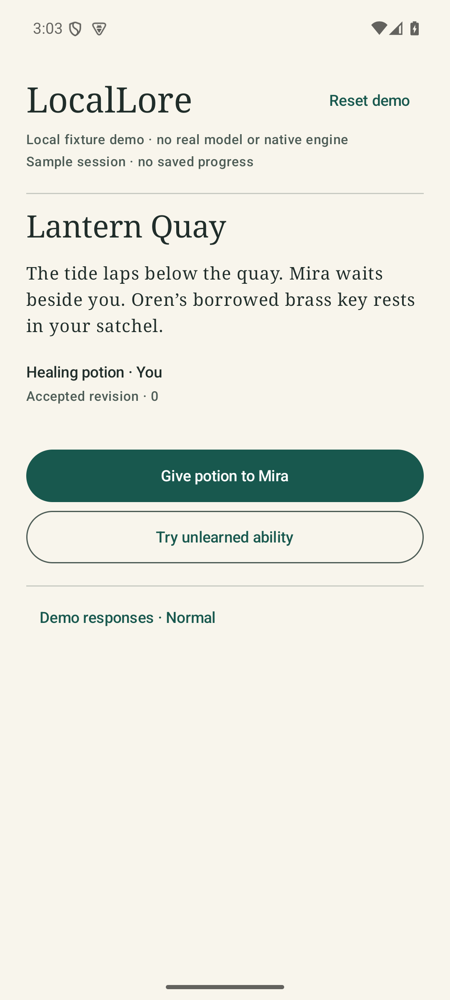

# Compose shell verification — 2026-10-22

M03.02, [ticket #7](https://github.com/OptimumAF/LocalLore/issues/7). This dated
artifact records actual execution, not owner acceptance or a milestone checklist.
The packet starts at unmerged PR #18 head `4f6c89c` and is reviewed as a separate
stacked implementation PR. The working tree was clean before this packet; no
human edits were overwritten and no PR or branch was merged.

## What runs

`apps/android/` contains a minimal Compose story screen and ViewModel with pending,
accepted, rejected, failure, cancellation and reset states. A finite local sample
adapter maps exact fake proposals to recorded Rust-validated outcomes. Four
versioned asset cases cover the first potion gift, spent-item reuse and an
unlearned ability before/after the gift. The host example regenerates/checks those
cases using the existing domain engine; Kotlin implements no gameplay rules.

The app explicitly says **local fixture demo, no real model or native engine,
no saved progress**. Accepted sample state survives Activity recreation, while
pending work is cancelled on `onStop` and disposal invalidates late results.
Process death resets the sample. This is not JNI, actual model execution, a
canonical Android ledger, SQLite durability or arbitrary free-text play.

The coordinator owns build, fixtures, shared types, lifecycle adapter, integration,
tests and ticket updates. A separate UI agent/worktree supplied the stateless
screen (`96d9dba`); a separate research/reviewer worktree supplied official pins
and concrete review findings (`16bdede`, `43dfbed`, `9347fb8`). Owned paths and
interfaces were recorded on #7 before edits. The coordinator integrated their
commits without changing their worktrees. All claims are handed off through the
implementation PR; no reviewer score is used as acceptance.

## Environment

Windows x86_64, installed OpenJDK 17.0.6, Gradle 8.11.1, AGP 8.10.1,
Kotlin/Compose compiler 2.2.21, Compose BOM 2025.05.01, Build Tools 35.0.0.
Compile/target SDK 36, provisional shell-only minimum 26. Official rationale and
license/source pins: [TOOLCHAIN_2026-10-22.md](TOOLCHAIN_2026-10-22.md),
[DEPENDENCY_SOURCES.json](DEPENDENCY_SOURCES.json).

Both authorized targets report `sdk_gphone64_x86_64`, Android 15/API 35,
1080×2400, and emulator status. The sanitized probe reports two emulators and
zero physical candidates (expected exit 2). No phone, model weights, private
story, credential, physical-device serial or personal log was used. Local reports
are summarized without hostnames, transport identifiers or user paths.

## Commands and results

Android commands run from `apps/android/` with Java 17 and the installed SDK
selected by environment variables. First provisioning used the official Gradle
distribution/Maven repositories; installed app behavior needs no network/account.

| Exact command or check | Actual result |
|---|---|
| `gradlew.bat :app:assembleDebug :app:assembleDebugAndroidTest --write-locks --no-daemon --console=plain` | Both debug APKs built |
| `gradlew.bat :app:testDebugUnitTest :app:assembleDebug :app:assembleDebugAndroidTest :app:lintDebug --no-daemon --console=plain --write-locks` | 8 JVM tests, 0 failed; debug APKs and lint passed |
| `gradlew.bat :app:connectedDebugAndroidTest :app:lintDebug --no-daemon --console=plain` | 7 instrumentation tests on each of 2 API-35 emulators; 14 passed, 0 failed/skipped; lint 0 errors |
| `gradlew.bat clean :app:assembleDebug :app:assembleDebugAndroidTest :app:testDebugUnitTest :app:lintDebug --offline --no-daemon --console=plain` | Clean offline rebuild and JVM/lint checks passed after dependency provisioning |
| `cargo run --locked --offline -p locallore --example android_fixtures -- --check` | 4 checked-in cases match actual Rust outcomes, contract v1 |
| `cargo test --workspace --locked --offline` | 26 Rust integration tests, 0 failed; includes 10,000 seeded attempts |
| `cargo clippy --workspace --all-targets --locked -- -D warnings` | Passed |
| `cargo fmt --all -- --check` | Passed |
| Official Gradle distribution/JAR SHA-256 comparison | Both matched; distribution pin in wrapper properties; wrapper JAR `2db75c40782f5e8ba1fc278a5574bab070adccb2d21ca5a6e5ed840888448046` |
| `aapt2 dump badging app-debug.apk`, merged manifest inspection and package-manager instrumentation assertion | min26/target36, exactly one app-owned signature permission, no platform network/media/contact/location permission |
| `zipalign -c -P 16 4 app-debug.apk` | Exit 0, final debug APK |
| `llvm-readelf -l` on four packaged graphics-path helpers | Every LOAD segment alignment `0x4000`, independent reviewer check |
| `adb install -r app-debug.apk`, explicit start of `org.locallore.app/.MainActivity` | Successful installation on both emulators and cold launch; LocalLore foreground verified before capture |
| `git diff --check` and staged equivalent | Passed |

Lint's six remaining warnings are pinned-version update advisories (Gradle,
Activity, two Lifecycle dependencies, test runner and test JUnit extension).
They are documented choices, not suppressed errors or a claim that these are the
latest libraries. [Sanitized machine-readable results](TEST_RESULTS_2026-10-22.json)
include test names, counts, warning messages, fixture digest and tested APK digest.
Raw XML/HTML/build reports remain ignored local build output.
The clean APK's archive digest differs from the incrementally built/tested APK;
comparison with the installed tested package found identical bytes for every ZIP
entry. Container-byte reproducibility is not claimed by this debug-shell packet;
both digests and the clean-build result are retained in the sanitized report.

## Regression and visual review

JVM coverage verifies publication only after accepted completion, duplicate-tap
suppression, unchanged projection/transcript on failure, cancellation/reset,
uncooperative late callbacks, old-job/new-job races and ViewModel disposal. A
new disposal regression initially **failed** when cancellation alone allowed a
noncancellable callback to publish. Advancing the generation token in `onCleared`
fixed the defect; the full eight-test suite then passed.

Instrumentation checks honest sample labels, actual package permissions,
gift/reuse and unlearned-ability outcomes, malformed/rejected/failed modes,
cancel/reset during delayed responses, Activity recreation, fixture scope/version,
and a 320×340 dp viewport at 2× font scale. The first emulator run exposed test
matcher/scroll issues: partial strings were accidentally matched exactly, and
lazy off-screen controls had not yet been composed. Tests now assert complete
state labels and scroll the LazyColumn to the desired node. The final run passed
all seven checks per target without relaxing the assertions about state.

Lint first caught an API-27 navigation-bar style at the proposed API-26 floor;
it was removed, rather than suppressing the compatibility error. Independent
review also corrected a zero-permission assumption (AndroidX's protected dynamic
receiver permission is expected), blanket license-resource exclusion, and a
misleading assumption that Compose bundles no native helper.

The actual initial screen was visually inspected after explicit install/launch
and a foreground check. It shows readable serif narrative, restrained teal actions,
sample-state labels and reachable controls with no overlap in the captured
configuration. The small-font/large-font/landscape product matrix and screen-reader
qualification remain future work. An initial capture obtained another screen
after instrumentation cleanup removed the app; it was discarded and is not in
Git. Only the verified LocalLore synthetic screen is retained:

## Limits and next task

API 26 and API 36 were not executed; their declared SDK values are not a supported
device matrix. Both tested devices are emulators, not physical phones. The APK
includes AndroidX's graphics-path helper for four ABIs; host ELF/ZIP alignment
does not qualify a 16 KiB device, ARM64 execution or future Rust/model libraries.
Backup exclusions and lack of INTERNET permission are architectural checks, not
a full OS-backup or outbound-traffic audit. No release package is qualified.

M03.02 is locally implemented and emulator-tested, **in_review** pending owner
acceptance. Full M03 remains open. Next runnable task is M03.03: replace the finite
sample gateway with the actual Rust/native boundary, verifying JSON/error mapping,
scope/revision/idempotency, background/UI-thread ownership, cancellation, callbacks
and deterministic resource disposal. M01 physical/model gates, M04 persistence,
and M03.05 CI remain separate. No merge, release, repository settings, account,
license or governance change was performed. Material AI assistance produced the
original code, synthetic fixtures, research and finite review.
