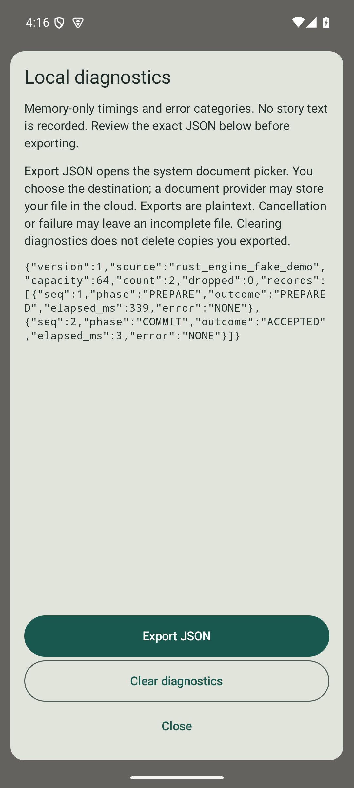

# Local diagnostic verification — 2026-10-22

Scope: M03.06, [#7](https://github.com/OptimumAF/LocalLore/issues/7).
Implementation and finite test evidence, not a security certification or owner
acceptance. The packet starts on verified #27 source and incorporates the
subsequent owner-authorized prerequisite merges without changing their files.
The focused PR targets `main`; this packet performs no merge or release.

## Behavior and ownership

The existing Rust/fake-inference demo records at most 64 enum/numeric entries
in its ViewModel memory. Elapsed times clamp to 0–60,000 ms, sequence/drop
counters saturate, and JSON v1 snapshots are ASCII and at most 16 KiB. Only
fixed phase/outcome/error categories can enter records. Unknown native strings
map to `UNKNOWN`; raw exception/category strings are not retained. No story,
actor/item, scope/session/request identifier, wall clock, path, URI or device
metadata field exists. Diagnostic metadata never changes canonical events.

The preview freezes an immutable snapshot. Clear explicitly replaces it with
empty records; export writes exactly the reviewed bytes despite later records.
The Android CreateDocument result only authorizes a write when the same
in-memory pending consent exists. Closing/resetting revokes consent. A separate
outstanding-picker latch drains an old result before allowing a new request;
stale/duplicate/post-process-death results cannot write. Rotation retains the
ViewModel preview and consent. Disposal clears memory and cancels export work.

Content-provider open/write/close and cancellation listeners run on IO. One
application-wide permit remains held through stream/descriptor and cancellation
cleanup; resources never cross a dispatcher boundary as returned descriptors.
Errors become fixed notices and categories, without private exception text.
An arbitrary provider may ignore cancellation/block and retain the slot: this
bounds app-created provider work, not provider termination. Plaintext exports
can be cloud-synced by the user-selected provider. Failure/cancellation may
leave incomplete copies; clearing does not delete exported files. The dialog
explains these limits before export. No collector, crash-upload SDK, automatic
file, clipboard, new dependency, permission or persistent URI grant is added.

[ADR-0005](../adr/0005-local-diagnostic-exports.md) defines the boundary;
[official sources](SOURCES_2026-10-22.md) and
[independent review](REVIEW_2026-10-22.md) record API/license and failure analysis.

## Independent work and corrections

Coordinator `impl/m03-local-diagnostics` owns integration, consent/controller,
writer, shared interfaces, tests outside agent ownership and evidence. Separate
worktrees/branches own the typed log/tests (`impl/m03-diagnostic-log`), stateless
dialog/tests (`impl/m03-diagnostic-view`) and source/privacy review
(`review/m03-diagnostics`). Claims and handoffs are on #7; commits were inspected
and integrated centrally. Independent review is not owner acceptance.

Review found an old picker result could bind a newer preview, and synchronous
CancellationSignal listeners could block Main. Separate consent/picker state
and asynchronous cancellation with a single held IO permit fix those paths;
adversarial regressions exercise both. The reviewer independently compiled and
ran 18 log/controller JVM tests, all passed.

Actual emulator testing found two fixture defects before acceptance. A Kotlin
test provider in its own process could not load target-APK Kotlin Intrinsics;
rewriting that test-only provider in platform/Java fixed the class loading.
The next 28-test trial completed with 27 passing and one remote cancellation
timeout. Android routes remote descriptor opens through openAssetFile; its
default implementation dropped the fixture's cancellation signal. An explicit
test-provider overload forwards it, preserving the timeout assertions. The
wrapped local-provider test already receives the signal directly. Neither fix
changes production behavior or adds dependencies. Dialog Configuration sizing
warnings were fixed using actual WindowInfo bounds, and the small-window test
now supplies and asserts those bounds.

## Checks

Environment: Windows x86_64, Rust/Cargo 1.93.1, JDK 17.0.6, Gradle 8.11.1,
AGP 8.10.1, Kotlin 2.2.21, Compose BOM 2025.05.01 (UI 1.8.2), Activity 1.10.1,
coroutines 1.10.2, SDK compile/target 36, provisional minimum 26,
Build Tools 35.0.0, NDK 29.0.14206865. No dependency/lock/production manifest
change is introduced.

Commands run from repository root except Gradle from `apps/android/`, with
JAVA_HOME/ANDROID_HOME selecting installed tools and ANDROID_SERIAL selecting
one authorized target per connected run. Provisioning can use network; the
checks below use offline caches and installed gameplay has no network dependency.

| Command/check | Result |
|---|---|
| `python scripts/check.py host --offline` | Passed: 26 domain + 8 FFI Rust tests, 4 fixture comparisons, 5 benchmark Python tests, 18 runner/APK Python tests, 3 linker tests, format and Clippy |
| `python scripts/check.py android --offline --clean` | Passed: 79 tasks executed, both Rust ABIs rebuilt, app/test APKs built, 30 JVM tests passed, lint zero issues, wrapper/permission/ZIP/ELF audit passed |
| `gradlew.bat :app:connectedDebugAndroidTest --offline --no-daemon --console=plain` per target | 28 passed per emulator; 56 total, zero failed/errors/skipped, against the same clean APKs |
| Explicit document-picker export to local Downloads | Passed on both: each 253-byte export equals its visible two-record preview exactly; subsequent picker cancellation observed on B; clearing on A refreshed count to zero and preserved its existing export byte-for-byte |

The clean app APK SHA-256 is
`fe44816f9c69cec46c73960afabeee7b419b8ced6561c72195205fc2bc54f141`;
test APK SHA-256 is
`1b169c273ef3a4f6a00b719ff7b20dc6dc3e57fde9b1f92145044c237bf4444c`.
Connected runs report assembly up to date and use those same clean packages.
No test provider class is present in application DEX; it is declared solely in
the test APK manifest. No production build/lock/manifest/Cargo dependency file
changed. The audit permits only AndroidX's app-owned signature permission and
checks all four native libraries' 16 KiB ZIP/ELF alignment. Offline lint is not
a current dependency vulnerability audit.

[Build counts/isolation](BUILD_RESULTS_2026-10-22.json),
[emulator A cases](EMULATOR_A_2026-10-22.json),
[emulator B cases](EMULATOR_B_2026-10-22.json) and
[explicit export comparison](EXPORT_RESULTS_2026-10-22.json) retain sanitized
results. Manual exports used actual UI controls observed with UIAutomator:
install/start app, give the potion, open diagnostics, capture its exact JSON,
choose Export JSON, select local Downloads with a new synthetic filename, Save,
then pull only that newly created file and compare bytes. No existing file is
overwritten. Exported numeric timings are not performance qualification.

The instrumented suite combines the prior 11 native/shell cases with eight
writer, five stateless dialog and four native/diagnostic integration cases.
It checks actual ContentResolver byte equality/truncation, exact byte cap,
invalid URI/oversize rejection before provider access, failure/null descriptors,
failed-write closure, twelve repeated writes, remote-open cancellation and
Main responsiveness. A wrapped local provider blocks its synchronous cancel
listener while tests assert Main responsiveness, descriptor closure and
exclusion of the second open until cleanup returns. UI cases test explicit
actions, disabled busy controls, Back, exact JSON, 320×420 dp bounds and doubled
font scale. Integration verifies real native outcomes are sanitized, clear
leaves accepted canon intact, rotation retains the reviewed snapshot/consent,
revoked callbacks cannot open a destination, and failed/cancelled generation
uses fixed categories. JVM tests additionally cover private exception canaries,
extreme counters/times, concurrency, late writes and post-process-death consent.

## Limits and handoff

Read-only inventory finds four emulators and no physical phone. This packet
selects two Android 15/API 35 x86_64 emulators with 4,096-byte pages, leaving the
other two untouched. ARM64 is built/packaged only. No ARM64/API 26/API 36/16 KiB
OS execution, physical/model performance, thermal/memory qualification, real
inference, backup/traffic audit, durable saves or release qualification follows.
Fake timing is plumbing metadata, not a model benchmark. Tests model process
death as absence of retained consent; they do not claim disk recovery.

Only original synthetic scene/provider data and deliberately created synthetic
exports are inspected. Raw UTP/Logcat/UI dumps remain ignored; no private player
content, arbitrary diagnostic file or device identifier is published. Full M03
and M01 device/model gates remain separate; task checkboxes stay unchecked until
their evidence and owner acceptance are recorded. M03.06 is implemented/locally
verified for review, not accepted. M04 retains its dependency gate. The next
step is owner review of this packet and reconciliation of remaining M03 gates;
M04.01 follows foundation acceptance. M01 host preparation can continue
independently, while its physical/model measurements remain blocked. Claims
transfer to PR review; exact final results and handoff are recorded on #7.
