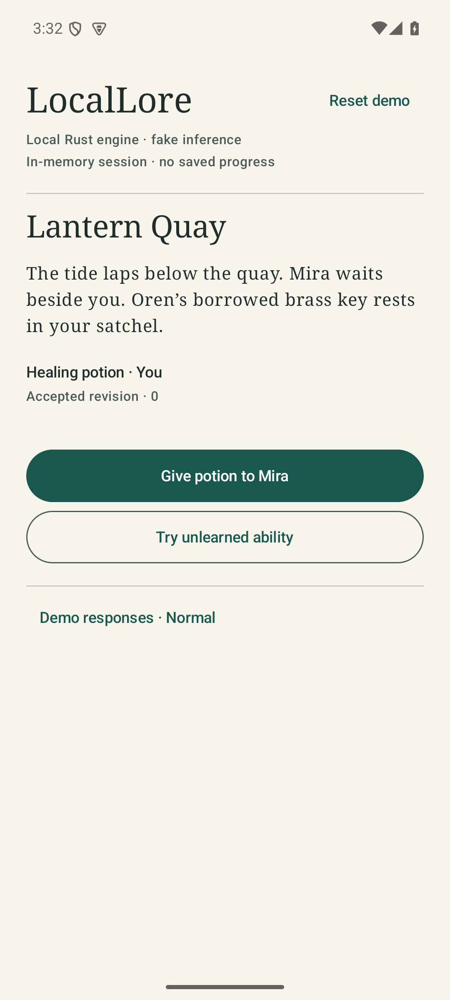

# Android Rust boundary verification — 2026-10-22

Scope: M03.03, [#7](https://github.com/OptimumAF/LocalLore/issues/7).
This is dated execution evidence, not owner acceptance or a replacement tracker.
The packet starts at unmerged Compose PR #19 head `d8f788e`, preserves prior work,
and is reviewed as a focused stacked PR. No branch/PR is merged.

## Implemented behavior

Compose now uses the actual Rust engine through one JNI byte-array method.
Rust owns canonical events/projections, scoped opaque IDs and cancellation.
Kotlin requests typed actions; it implements no domain rules. The original fake
provider proposes, Rust validates, and the fake narrator renders accepted effects.
Generation prepares on a clone in a Kotlin IO worker. Owner-thread commit and
UI publication form a non-suspending step. Reset/disposal invalidate old IDs,
signal cancellation and release retained worker ownership. Exact retries do not
double-apply events or spend resources again. Unknown commit transport failure
requires reset without a rollback claim. See [ADR-0004](../adr/0004-android-engine-boundary.md).

The previous recorded gateway and JSON cases are test-only and absent from the
APK. The UI says **Local Rust engine · fake inference** and **In-memory session ·
no saved progress**. This is actual native engine execution with synthetic data,
not real-model inference, arbitrary player text, storage or a production runtime.

## Environment and independent work

Windows x86_64; Rust/Cargo 1.93.1; Java 17.0.6; Gradle 8.11.1; AGP 8.10.1;
Kotlin/Compose compiler 2.2.21; Compose BOM 2025.05.01; Build Tools 35.0.0;
NDK r29 `29.0.14206865`; compile/target SDK36; provisional minimum26.
JNI `0.21.1`, invocation disabled, is deliberately older than current `0.22.4`.
Official compatibility, API/license rationale and build instructions:
[sources](SOURCES_2026-10-22.md), [build](BUILD.md),
[full Cargo registry inventory](DEPENDENCY_SOURCES.json). Lockfile checksums are
preserved. No inference runtime/model dependency or weights are added.

Read-only ADB probe: four authorized emulators, zero physical candidates
([sanitized result](DEVICE_PROBE_2026-10-22.json), expected exit2). Two selected
emulators execute this packet; two others are untouched. Both tested targets are
`sdk_gphone64_x86_64`, Android15/API35, 1080×2400, 4,096-byte pages. Installed
emulator binary:35.3.12.0/build12990079. No serials, hostnames, private stories,
weights or raw personal/device logs enter this report.

Coordinator branch `impl/m03-native-engine` owns shared v1 controls, Rust session
crate, Kotlin adapter/lifecycle, integration and evidence. Independent build
worktree `impl/m03-native-build` owns the Gradle native helper, linker launcher
and BUILD document. Independent review worktree `review/m03-native-boundary`
owns source/review documents and public host boundary tests. Claims/interfaces
were posted on #7 before work; agent commits were cherry-picked and inspected.
Neither agent changes shared contracts concurrently or grants owner acceptance.

Review corrected retained-session/operation admission, checked ID allocation,
and misleading failure text after unknown commit completion. Clippy requested
boxing the prepared receipt. Actual builds exposed Gradle child-output handling
and Rust1.93.1 response-file quoting with an apostrophe in the workspace path;
the std-only launcher reconstructs bounded build arguments without moving the
workspace or invoking a command shell. Its source rationale and tests are linked
in BUILD. No public gameplay control can invoke this build helper.

## Checks

Android commands run from `apps/android/` with Java17 and the installed SDK.
Host commands run at the repository root. Provisioning may use network; these
checks use cached offline dependencies and installed gameplay needs no network.

| Command/check | Result |
|---|---|
| `cargo test --workspace --locked --offline` | 26 domain + 8 public native-boundary tests passed; zero failures; domain suite includes 10,000 seeded attempts |
| `cargo fmt --all -- --check` | Passed |
| `cargo clippy --workspace --all-targets --locked --offline -- -D warnings` | Passed |
| `cargo clippy -p locallore-android --target x86_64-linux-android --lib --locked --offline -- -D warnings` | Passed, including JNI code |
| Same target clippy command with `aarch64-linux-android` | Passed |
| `cargo run --locked --offline -p locallore --example android_fixtures -- --check` | Four legacy test-only cases still match engine outcomes |
| `rustc +1.93.1 --test apps/android/native-linker.rs -o target/native-linker-tests.exe`, then execute it | Three tests passed: escaped paths/apostrophes/Unicode, GNU quoting, fail-closed malformed escapes |
| `gradlew.bat :app:assembleDebug :app:assembleDebugAndroidTest :app:testDebugUnitTest :app:lintDebug --offline --no-daemon --console=plain` | Actual Rust release libraries for x86_64/ARM64 built; app/test APKs built; 11 JVM tests passed; lint reports no issues |
| `gradlew.bat clean :app:assembleDebug :app:assembleDebugAndroidTest :app:testDebugUnitTest :app:lintDebug --offline --no-daemon --console=plain` | Clean offline rebuild passed:78 tasks executed, both Rust ABIs rebuilt, 11 JVM tests passed, lint no issues |
| `gradlew.bat :app:connectedDebugAndroidTest --offline --no-daemon --console=plain`, one selected `ANDROID_SERIAL` per run | 11 tests per emulator, zero failed/skipped; reports below distinguish clean final APK runs |
| `zipalign -c -P 16 4 app-debug.apk` | Exit0, clean APK |
| `llvm-readelf -l` and independent ELF64 program-header parsing of final APK entries | All LOAD alignments `0x4000` for both Rust and both AndroidX graphics-path libraries |
| `aapt2 dump badging`, manifest inspection and package-manager test | Exactly x86_64/arm64-v8a; min26/target36; only app-owned AndroidX signature permission; no platform network/media/contact/location permission |
| Explicit `adb install -r` and `am start -W -n org.locallore.app/.MainActivity` | Both clean installs/foreground launches verified; per-process startup logs positively report CheckJNI enabled, no observed JNI abort/fatal exception |
| `git diff --check` / staged equivalent | Passed before handoff |

The clean APK differs from the incremental archive, including `classes4.dex`.
Native-library entry bytes match. Instrumentation is therefore rerun against
the clean APK on both targets; no equivalence of those DEX payloads or byte-level
package reproducibility is claimed. [Summary/digests](TEST_RESULTS_2026-10-22.json)
and [emulator A](EMULATOR_A_2026-10-22.json)/[emulator B](EMULATOR_B_2026-10-22.json)
contain sanitized exact cases/counts. Raw Gradle/UTP reports remain ignored.
Offline lint success is not a current dependency vulnerability/freshness audit.

## What the tests establish

Raw JNI tests pass null/oversized arrays, malformed UTF-8, unknown fields,
unsupported versions, foreign scope, destroyed handles and wrong-thread controls.
The real engine gives the potion, records one event, exposes Mira's observation
but no absent Sable observation, spends learned-ability energy, and rejects
resource reuse. Preparation alone leaves revision0; repeated commit returns the
same accepted receipt. Cancel before run/after prepare leaves zero events.

Each emulator exercises 20 running cancellation/destruction cycles plus fresh
sessions, waiting for live/retained session, operation and worker counts to
return to baseline. Activity disposal during delay returns all counts to zero.
Compose tests exercise native accepted/rejected/malformed/failed flows, duplicate
item use, cancel/reset, recreation and doubled-font small layout. JVM tests cover
late/noncooperative completions, disposal, no commit after invalidation and
uncertain-commit recovery. Host tests additionally race cancel against owner
commit20 times and test session admission/idempotency/scoped IDs. These are finite
ownership assertions, not a general native leak/sanitizer or performance proof.

## Limits and handoff

ARM64 is cross-built/packaged, not executed. No API26/36 or 16KiB OS execution,
physical phone, real model, thermal/memory-pressure/low-storage qualification,
disk/process-death durability, SQLite, narrative-quality or release claim.
No JVM callback exists to retain or dangle; future callbacks/backends require
new ownership checks. Abort/OOM may terminate the process. Demo bounds are
32 retained sessions,64 retained operations,one current operation/session and
64 committed turns; production limits/recovery await later evidence.

M03.03 is implemented/locally verified for review; task checkboxes stay unchecked
until owner acceptance. Full M03 remains open. M01 physical/model gates remain
blocked; M03.05 safe CI/development checks is the next runnable task without
changing Actions settings. M03.06 diagnostics and M04 persistence remain pending.
Material AI assistance: coordinator implementation/integration and independent
build/review agents; original synthetic fixtures only. No merge, release,
access/settings change, cloud inference or telemetry is performed.

